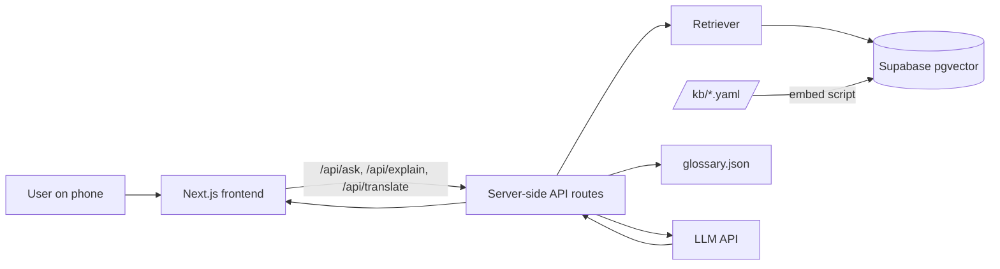

# AyaSib - Cebuano-first Services Assistant

> *AyaSib* means "help" in Cebuano. (Working name - rename freely.)

Ask about government services in Bisaya and get a short, step-by-step answer in Bisaya, with the source and the date it was last verified.

**Live demo:** `TODO: add deployed URL`
**Demo video:** `TODO: add link`

<!-- Badges: replace methuselahnoreen/AyaSib once the repo exists -->


---

## Table of contents

1. [The problem](#the-problem)
2. [What AyaSib does](#what-AyaSib-does)
3. [How it avoids wrong answers](#how-it-avoids-wrong-answers)
4. [Architecture](#architecture)
5. [Tech stack](#tech-stack)
6. [Getting started](#getting-started)
7. [Environment variables](#environment-variables)
8. [Project structure](#project-structure)
9. [Knowledge base format](#knowledge-base-format)
10. [Glossary format](#glossary-format)
11. [API reference](#api-reference)
12. [Testing and evaluation](#testing-and-evaluation)
13. [Security](#security)
14. [Deployment](#deployment)
15. [Limitations](#limitations)
16. [Roadmap](#roadmap)
17. [Contributing](#contributing)
18. [Team](#team)
19. [License](#license)

---

## The problem

Most government and service information in Cebu (permits, clearances, PhilHealth steps, disaster advisories) is written in English or formal Filipino. Many Cebuano speakers, especially older people and people in outlying barangays, do not read these comfortably. Generic translators handle Cebuano poorly and know nothing about local procedures. People end up asking relatives or fixers, or standing in the wrong line at the wrong office.

## What AyaSib does

Three features, deliberately and no more.

### 1. Ask in Bisaya
Type a question such as *"Unsaon pag-apply ug barangay clearance?"* and receive a short checklist:

- Requirements
- Where to go
- Typical fee
- Processing time
- Source link and **last verified** date

### 2. Explain this document
Paste text or upload a photo of a notice or form. AyaSib explains in plain Cebuano what the document is, what it asks for, and what to do next.

### 3. Translate with government vocabulary
English or Filipino to Cebuano and back, using a small curated glossary so terms like *affidavit* or *business permit* are translated consistently instead of guessed.

**Stretch (not required):** turn PAGASA / NDRRMC advisories into simple Cebuano.

## How it avoids wrong answers

Wrong information about a government process can cost people time and money, so reliability is the core design goal, not an afterthought.

| Safeguard | How it works |
|-----------|--------------|
| **Grounded answers only** | The model may answer only from retrieved knowledge-base files. |
| **Citations on every answer** | Each answer shows its source URL and `last_verified` date. |
| **Refusal fallback** | If sources do not cover the question, AyaSib says it is not sure and tells the user to confirm with the office. |
| **Curated glossary** | Government terms use fixed Cebuano renderings. |
| **Evaluation set** | 30-50 Cebuano questions with expected answers, run in CI, reviewed by a native speaker. |

## Architecture



1. Service information lives as YAML files in `/kb`.
2. An embedding script loads them into Supabase pgvector.
3. On each question, the API retrieves the most relevant files.
4. A strict prompt, plus the glossary, instructs the LLM to answer in Cebuano using only those files.
5. The API returns a structured answer with sources, or a "not sure" response.

> `TODO: replace with the final diagram once the architecture is settled.`

## Tech stack

| Layer | Choice |
|-------|--------|
| Frontend | Next.js, mobile-first, large-text chat layout |
| Backend | Next.js API routes (or separate service - `TODO: confirm`) |
| Database / vectors | Supabase Postgres with pgvector |
| LLM | `TODO: provider and model` |
| OCR (Feature 2, images) | `TODO: choose` |
| Tests | `TODO: e.g. Vitest + Playwright` |
| CI | GitHub Actions |
| Hosting | `TODO: e.g. Vercel` |

## Getting started

### Prerequisites

- Node.js `TODO: version` and a package manager (`npm`, `pnpm`, or `yarn`)
- A Supabase project with the `pgvector` extension enabled
- An API key for the chosen LLM provider

### Setup

```bash
# 1. Clone
git clone https://github.com/methuselahnoreen/AyaSib.git
cd AyaSib

# 2. Install
npm install

# 3. Configure environment
cp .env.example .env.local
# then fill in the values (see "Environment variables")

# 4. Load the knowledge base into the vector store
npm run kb:embed

# 5. Run locally
npm run dev
```

Open `http://localhost:3000`.

> `TODO: confirm every script name matches package.json.`

## Environment variables

Copy `.env.example` to `.env.local` and fill in:

| Variable | Used by | Notes |
|----------|---------|-------|
| `LLM_API_KEY` | Server only | **Never** prefix with `NEXT_PUBLIC_` |
| `SUPABASE_URL` | Server | Project URL |
| `SUPABASE_SERVICE_ROLE_KEY` | Server only | Full-access key; never expose to the browser |
| `NEXT_PUBLIC_APP_URL` | Browser | Safe to expose; no secrets here |

> `TODO: reconcile with the final .env.example.`

Real keys must never be committed. `.env*` files are git-ignored.

## Project structure

```
.
├── web/                 # Next.js app (UI and API routes)
├── kb/                  # One YAML file per service
├── glossary/
│   └── glossary.json    # Preferred Cebuano terms
├── eval/                # Question set and runner
├── scripts/             # Embedding and maintenance scripts
├── docs/
│   ├── api-contract.md
│   └── TEAM_KICKOFF.md
├── .github/             # CI workflows, PR and issue templates
├── .env.example
├── CONTRIBUTING.md
└── LICENSE
```

> `TODO: update to match the real layout.`

## Knowledge base format

Each service is one YAML file in `/kb`:

```yaml
id: barangay-clearance
name_en: Barangay Clearance
name_ceb: Barangay Clearance
requirements:
  - Valid ID
  - Proof of residency
fee: "TODO"
office: "Barangay Hall of your residence"
processing_time: "TODO"
source_url: "https://example.gov.ph/..."
last_verified: 2026-10-01
```

Rules for contributors:

- Every file **must** have `source_url` and `last_verified`.
- Do not guess fees or requirements. If you cannot verify it, leave it out.
- Fees and procedures differ by city and barangay; say which locality the file covers.
- Re-verify and update `last_verified` whenever you change a file.

## Glossary format

```json
{
  "affidavit": "sinumpaang pahayag",
  "business permit": "permiso sa negosyo"
}
```

> The values above are **examples only** and must be reviewed by a native Cebuano speaker before use.

## API reference

Full details in [`docs/api-contract.md`](docs/api-contract.md).

### `POST /api/ask`

```json
// request
{ "question": "Unsaon pag-apply ug barangay clearance?" }

// response
{
  "answer": {
    "summary": "...",
    "requirements": ["..."],
    "office": "...",
    "fee": "...",
    "processing_time": "..."
  },
  "sources": [
    { "title": "...", "url": "...", "last_verified": "2026-10-01" }
  ],
  "confident": true
}
```

When `confident` is `false`, the UI shows the "not sure, please confirm with the office" message instead of a checklist.

### `POST /api/explain`

```json
// request
{ "text": "..." }
// response
{ "explanation": "...", "next_steps": ["..."] }
```

### `POST /api/translate`

```json
// request
{ "text": "...", "from": "en", "to": "ceb" }
// response
{ "translation": "..." }
```

## Testing and evaluation

```bash
npm run lint
npm test
npm run eval      # runs the Cebuano question set
```

- **Unit and integration tests** cover retrieval, the refusal fallback, and glossary injection.
- **Evaluation set** (`/eval`): 30-50 Cebuano questions with expected answers, reviewed by a native speaker. CI runs it on every pull request.

**Latest eval results:** `TODO: add pass rate and date after the first run.`

## Security

- API keys are used server-side only and are never sent to the browser.
- No secrets are committed; `.env*` is git-ignored.
- Rate limiting and input-size limits on all API routes. `TODO: confirm implemented.`
- Uploaded images are validated by type and size. `TODO: confirm implemented.`
- Found a vulnerability? Please open a private security advisory on GitHub rather than a public issue.

## Deployment

- **Hosting:** `TODO`
- **Environment variables:** set in the host's settings, never in the repo.
- **Steps:** `TODO: document the exact deploy steps and how the KB is re-embedded after changes.`
- **Scalability notes:** `TODO: e.g. stateless API routes, pgvector index, caching of repeated questions.`

## Limitations

Please read these before relying on AyaSib.

- **Not official.** AyaSib is an independent project and is not affiliated with any government office.
- **Information can go out of date.** Always check the "last verified" date and confirm with the office for anything important.
- **Limited coverage.** Only the services in `/kb` are supported. Other questions get the "not sure" response.
- **Cebuano quality.** LLMs are weaker in Cebuano than in English. The glossary and eval set reduce this risk but do not remove it.
- **Local variation.** Fees and steps can differ by city, barangay, and office.
- **Photo explanations** may misread blurry or handwritten text.

## Roadmap

- [ ] More services and more localities
- [ ] PAGASA / NDRRMC advisory simplifier
- [ ] Offline-friendly or low-bandwidth mode
- [ ] Voice input and read-aloud for users who read less comfortably
- [ ] Community process for reporting outdated KB entries

## Contributing

Contributions are welcome, especially **verified knowledge-base entries** and **Cebuano glossary and eval reviews**.

1. Read [`CONTRIBUTING.md`](CONTRIBUTING.md).
2. Pick an issue labelled `good first issue`, `kb`, `glossary`, or `eval`.
3. Branch from `main` (`feat/...`, `fix/...`, `docs/...`).
4. Open a pull request using the template and make sure the checklist passes.

## Team

| Name | Role |
|------|------|
| `TODO` | Project Manager, Frontend |
| `TODO` | Frontend |
| `TODO` | Backend |
| `TODO` | Backend |

Native Cebuano reviewer: `TODO`

## License

`TODO: MIT` - see [`LICENSE`](LICENSE).

## Acknowledgements

Built for `TODO: hackathon name`. Thanks to everyone who reviewed our Cebuano and verified service information.

