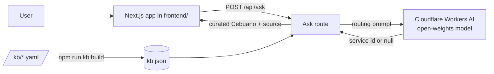

# AyaSib - Cebuano-first Government Services Assistant

> *AyaSib* means "help" in Cebuano (Bisaya).

Ask about a Cebu City government service in Bisaya, Filipino, or English, and get a short checklist back **in Bisaya**: a summary, what to bring, where to go, the fee, and how long it takes, each answer shown with its official source and the date it was last verified. If the knowledge base does not cover your question, AyaSib says it is not sure and tells you to confirm with the office. It never guesses.

**Live demo:** <https://ayasib.vercel.app>
**Built for:** Hacktoberfest Cebu 2026 open-source competition.

[](https://github.com/methuselahnoreen/AyaSib/actions/workflows/ci.yml)
[](LICENSE)

Project history is recorded in [`CHANGELOG.md`](CHANGELOG.md).

---

## Table of contents

1. [The problem](#the-problem)
2. [What AyaSib does](#what-ayasib-does)
3. [How it avoids wrong answers](#how-it-avoids-wrong-answers)
4. [Architecture](#architecture)
5. [Tech stack](#tech-stack)
6. [Getting started](#getting-started)
7. [Environment variables](#environment-variables)
8. [Project structure](#project-structure)
9. [Knowledge base format](#knowledge-base-format)
10. [How to add a service](#how-to-add-a-service)
11. [API reference](#api-reference)
12. [Testing and evaluation](#testing-and-evaluation)
13. [Security](#security)
14. [Deployment](#deployment)
15. [Limitations](#limitations)
16. [Roadmap](#roadmap)
17. [Contributing](#contributing)
18. [Team](#team)
19. [License](#license)

---

## The problem

Most government information in Cebu (clearances, civil registry documents, permits) is written in English or formal Filipino. Many Cebuano speakers, especially older people and those in outlying barangays, do not read these comfortably. Generic translators handle Cebuano poorly and know nothing about local procedures, so people end up asking relatives or fixers, or lining up at the wrong office.

## What AyaSib does

### Ask in Bisaya (working today)

Type a question such as *"Unsaon pagkuha ug death certificate sa City Health?"* and get a short checklist drawn from a curated knowledge base:

- Summary of the service
- Requirements (what to bring)
- Steps, when the service has them
- Office, fee, and processing time
- The official source link and its **last verified** date

If no service in the knowledge base matches, AyaSib replies *"Dili ko sigurado niini. Palihug kumpirmaha sa opisina."* ("I'm not sure about this. Please confirm with the office.")

### Explain a document and Translate (frontend-owned)

The web app also has an **Explain this document** feature and a **Translate** feature, built and owned by the frontend team under `frontend/src/app`. They follow the same hard rule as Ask: only open-source models, and no invented facts. This README focuses on the Ask backend; see the frontend sources for those two.

### Readiness view — "Andam Na?" (working today)

Each supported service has a per-service readiness view at `/andam/<service-id>` that is built entirely from existing KB fields. It never invents a fact.

- **Readiness checklist.** One item per requirement, drawn from the service's `requirements_ceb` (falling back to `requirements`). Each item can be marked *Naa na* (have it), *Kinahanglan pa* (still need), or *Susihon* (confirm). Progress is saved **only on your device** (browser `localStorage`), attached to the requirement's text rather than its position, so reordering or editing the list never moves your marks to the wrong item. When a service has no requirements listed, the view says so instead of showing an empty checklist.
- **Next recommended action.** A single Cebuano hint derived only from the service's verified `next_step`/`next_step_ceb`, or from your remaining items, with a safe "confirm with the office" fallback. It never claims acceptance or eligibility.
- **Verified navigation.** A next step and links to officially related services, shown **only** when the KB entry already carries that data (`next_step`/`next_step_ceb` and a `related` list of other service ids). Unresolved related ids are dropped.
- **Freshness and information status.** The view shows the service's `last_verified` date and a computed status — *Na-verify* (Verified), *Kinahanglan susihon* (Needs review), *Wala pa ma-kumpirma* (Unconfirmed), or a distinct **verification-date-unavailable** notice when the date is missing, unparseable, or in the future. A Cebuano clarifier reminds the user that a verification date is not a guarantee that requirements are unchanged.
- **Report outdated info.** A client-only control opens a **prefilled GitHub issue** in the public project repository for a maintainer to review against an official source. It makes no server call, stores nothing on any AyaSib server, and exposes no secret. If no repository is configured, it shows a plain "confirm with the office" message instead.

All Cebuano strings here are first-draft and flagged for native-speaker review, like the rest of `frontend/src/lib/strings.ts`.

## How it avoids wrong answers

Wrong information about a government process costs people time and money, so reliability is the core design goal.

| Safeguard | How it works |
|-----------|--------------|
| **The model only routes, it never writes facts** | For Ask, the model's only job is to pick which knowledge-base service a question is about, or answer `null`. It does not write the answer text. |
| **Curated Cebuano, not machine Cebuano** | Every Cebuano string shown to users is hand-written and reviewed by a native speaker in the KB file. The model is not trusted to produce Cebuano, because its own Cebuano contained real errors in testing. |
| **Facts come only from the KB** | Fees, offices, requirements, the source URL, and `last_verified` all come from the YAML file, never from the model. |
| **Citations on every answer** | Each answer carries its source title, URL, and `last_verified` date. |
| **Refusal fallback** | If the model picks nothing, or picks an id that is not in the KB, the answer is an honest "not sure". |
| **Evaluation set** | A set of Bisaya questions (including ones the KB does not cover and deliberately vague ones) is run with `npm run eval` and checked against expected results. |

## Architecture



1. Each service is one YAML file in `kb/`. These are the source of truth.
2. `npm run kb:build` validates the files and writes `backend/data/kb.json` with only the services that pass.
3. On each question, the Ask logic sends the question plus a short list of services to an **open-weights model on Cloudflare Workers AI**. The model replies with one service id, or `null`.
4. The code looks that id up in the KB and returns the curated Cebuano fields plus the source. If the id is missing or `null`, it returns the "not sure" response.

There is no vector database in the current design. With only a handful of services, a plain list in the prompt is enough to route reliably. A pgvector-based retriever is kept as a future step for when the KB grows (see [Roadmap](#roadmap)).

## Tech stack

| Layer | Choice |
|-------|--------|
| Frontend + API | Next.js (App Router), API routes under `frontend/src/app/api` |
| Ask routing model | Cloudflare Workers AI, default `@cf/qwen/qwen3-30b-a3b-fp8` (open weights) |
| Knowledge base | YAML files in `kb/`, validated and built into JSON |
| KB tooling | Node scripts in `backend/` (`js-yaml`) |
| Tests / eval | Node scripts; `npm run eval` for the question set |
| Hosting | Vercel (root directory `frontend`) |

**Why this model.** The competition requires any AI model to be open source / open weights, so closed models such as Gemini and Claude are not used. Qwen3 is released under the Apache 2.0 license ([Qwen3 model card on Hugging Face](https://huggingface.co/nvidia/Qwen3.6-35B-A3B-NVFP4)), and Cloudflare Workers AI hosts it with a free daily allocation, which fits a hackathon budget. A second open model, `@cf/openai/gpt-oss-120b`, can be selected via `LLM_MODEL` for comparison. (Content rephrased for licensing compliance.)

## Getting started

The knowledge-base tooling and the Ask logic live in `backend/`. The web app lives in `frontend/`. The commands below set up the backend tooling and run the command-line Ask tester.

### Prerequisites

- Node.js 20 or newer (the scripts use `--env-file`, available from Node 20)
- A Cloudflare account with Workers AI enabled, and an API token with the Workers AI permission

### Setup (backend tooling)

```powershell
# From the repository root:
cp .env.example .env.local
# then open .env.local and fill in CLOUDFLARE_ACCOUNT_ID and CLOUDFLARE_API_TOKEN

cd backend
npm install
npm run kb:validate     # check every kb/*.yaml file
npm run kb:build        # write backend/data/kb.json from the files that pass
```

### Try the Ask logic from the command line

```powershell
# still inside backend/
node --env-file=../.env.local scripts/ask-cli.mjs "Unsaon pagkuha ug death certificate sa City Health?"
```

Pass your own questions as arguments, or run with no arguments to use a built-in set. Set `DEBUG_ROUTER=1` in the terminal to print the raw model reply.

### Extract text from a photo

From `backend/`, run the OCR script with a JPEG or PNG image. It uses Cloudflare Workers AI, so the same account ID and token used by Ask are required. The image is sent to Cloudflare for OCR; use only images you are permitted to upload.

```powershell
npm run photo:ocr -- "..\path\to\photo.jpg"
```

To also ask the backend knowledge base about the extracted text:

```powershell
npm run photo:ocr -- "..\path\to\photo.jpg" --ask "Which service is shown, and what should I do next?"
```

The OCR model defaults to `@cf/microsoft/trocr-large-printed`; set `OCR_MODEL` to override it. This model is intended for printed text, not handwriting.

### Run the web app

The Next.js app is in `frontend/` (`npm run dev`, `npm run build`). When run locally, it loads server-side settings from the repository-root `.env.local`. The deployed app reads `CLOUDFLARE_ACCOUNT_ID` and `CLOUDFLARE_API_TOKEN` from the host's environment settings.

## Environment variables

Copy `.env.example` to `.env.local` (git-ignored) and fill in:

| Variable | Used by | Notes |
|----------|---------|-------|
| `CLOUDFLARE_ACCOUNT_ID` | Server only | Your Cloudflare account ID |
| `CLOUDFLARE_API_TOKEN` | Server only | Token with the Workers AI permission. **Never** prefix with `NEXT_PUBLIC_` |
| `LLM_MODEL` | Server only | Optional. Overrides the default model id |
| `OCR_MODEL` | Server only | Optional. Overrides the default photo OCR model id |
| `NEXT_PUBLIC_GITHUB_REPO` | Client (public) | Optional. `owner/name` of the public repo the "report outdated info" control files issues against. Defaults to `methuselahnoreen/AyaSib`. This is a public repo path, not a secret. |
| `NEXT_PUBLIC_STALE_THRESHOLD_DAYS` | Client (public) | Optional. Whole number of days before a `last_verified` date is treated as stale. Defaults to 180. |

Only `NEXT_PUBLIC_GITHUB_REPO` and `NEXT_PUBLIC_STALE_THRESHOLD_DAYS` are exposed to the browser; both are non-secret configuration. The Cloudflare and `LLM_*` values stay server-side. Real keys must never be committed or pasted in chat. `.env.local` and all `.env.*` files are git-ignored (except `.env.example`).

## Project structure

```
.
├── backend/
│   ├── data/kb.json            # generated; only services that pass validation
│   ├── lib/ask.mjs             # answerQuestion(): routes a question, returns the API shape
│   ├── scripts/
│   │   ├── validate-kb.mjs     # kb:validate and kb:build
│   │   ├── ask-cli.mjs         # command-line Ask tester
│   │   ├── photo-ocr.mjs       # extracts printed text from a photo; can query the KB
│   │   └── eval.mjs            # runs eval/questions.json, prints a pass rate
│   └── package.json            # backend tooling and CLI scripts
├── frontend/                   # Next.js app and its API routes (frontend team)
├── kb/                         # one YAML file per service (source of truth)
├── eval/
│   └── questions.json          # Bisaya eval questions with expected service ids
├── docs/
│   ├── APIContract.md
│   ├── TASKS.md
│   └── TeamKickoff.md
├── .env.example
├── CONTRIBUTING.md
└── LICENSE
```

## Knowledge base format

Each service is one YAML file in `kb/`. The file name (without `.yaml`) must equal the `id`. English fields describe the service; the `_ceb` fields are the hand-reviewed Cebuano shown to users.

```yaml
id: death-certificate-chd            # must match the file name
name_en: Death Certificate (City Health Department)
name_ceb: null                       # null until a native speaker supplies it
locality: Cebu City
office: "City Health Department (CHD)"
requirements:
  - "Medical abstract, laboratory results or prescription, if available"
fee: "PHP 50.00 (burial permit)"
processing_time: "45 minutes in total"
source_title: "Cebu City Citizen's Charter, Service 6: Issuance of Death Certificate"
source_url: "https://www.cebucity.gov.ph/transparency/citizens-charter/"
last_verified: 2026-10-14
summary_ceb: "Kini nga death certificate gi-isyu sa City Health Department..."
requirements_ceb:
  - "Medical abstract, resulta sa laboratoryo o reseta, kon naa"
office_ceb: "City Health Department (CHD)"
fee_ceb: "PHP 50.00 (burial permit)"
processing_time_ceb: "45 ka minuto sa tanan"
```

Rules enforced by `npm run kb:validate`:

- `id`, `name_en`, `locality`, `summary_ceb`, `source_title`, `source_url` must be present.
- `office`, `fee`, `processing_time` must be present or explicitly `null`.
- `requirements` and `requirements_ceb` must be non-empty lists of the **same length**.
- If `steps` is present, `steps_ceb` must have the same number of items.
- `source_url` must be a real `https://` address (no `TODO`, no `example.*`).
- `last_verified` must be a real date, not in the future.
- No two requirements may be identical after normalization (trim and collapse internal whitespace; case and punctuation preserved), checked separately for `requirements` and `requirements_ceb`.

Only files that pass are written into `kb.json` by `npm run kb:build`.

### Optional fields for the readiness view (additive)

These five fields are optional. Existing entries omit them and stay valid. They are validated only when present and must be authored from the same official source as the rest of the entry — never invented.

| Field | Meaning | Validation when present |
|-------|---------|-------------------------|
| `next_step` / `next_step_ceb` | The official next action after this service (English / Cebuano). | Non-empty text. |
| `related` | Service ids officially related to this one. | A list of lowercase-hyphenated ids, each resolving to a validated entry. |
| `review_status` | Reliability flag. | One of `verified`, `needs_review`, `unconfirmed`. |
| `review_due` | Date the entry is due for rechecking. | A real calendar date. |

## How to add a service

1. Copy an existing file in `kb/` (for example `kb/nbi-clearance.yaml`) to `kb/<your-service-id>.yaml`.
2. Fill in the English fields from an **official source**. Record `source_title`, `source_url`, and the `last_verified` date you actually checked it.
3. Write the Cebuano `_ceb` fields. Keep `requirements_ceb` in the same order and length as `requirements`. Do not machine-translate; have a native speaker write or review them. Leave `name_ceb: null` until a native speaker supplies it.
4. Do not guess a fee or requirement. If you cannot verify it, use `null` or leave it out. A missing fact is better than a wrong one.
5. From `backend/`, run `npm run kb:validate` until it passes, then `npm run kb:build`.
6. Test it: `node --env-file=../.env.local scripts/ask-cli.mjs "a question about your service"`.
7. Open a pull request. See [CONTRIBUTING.md](CONTRIBUTING.md).

## API reference

Full details in [`docs/APIContract.md`](docs/APIContract.md).

### `POST /api/ask`

```json
// request
{ "question": "Unsaon pagkuha ug death certificate sa City Health?" }

// response (confident)
{
  "confident": true,
  "answer": {
    "summary": "Kini nga death certificate gi-isyu sa City Health Department...",
    "requirements": ["Medical abstract, resulta sa laboratoryo o reseta, kon naa"],
    "requirements_note": null,
    "steps": [],
    "office": "City Health Department (CHD)",
    "fee": "PHP 50.00 (burial permit)",
    "processing_time": "45 ka minuto sa tanan"
  },
  "sources": [
    {
      "title": "Cebu City Citizen's Charter, Service 6: Issuance of Death Certificate",
      "url": "https://www.cebucity.gov.ph/transparency/citizens-charter/",
      "last_verified": "2026-10-14"
    }
  ]
}
```

When `confident` is `false`, `answer` is `null` and a Cebuano `message` is included. The UI shows the "not sure, please confirm with the office" state.

## Testing and evaluation

```powershell
cd backend
npm run kb:validate
npm run eval          # routes each eval question and prints a pass rate
```

The eval set (`eval/questions.json`) contains Bisaya, Filipino, and English questions that should map to a service and others that should be refused (out-of-KB services and deliberately vague ones). It also covers readiness-view scenarios: a fee/processing-time question, a freshness/review question, a next-step/related pathway, a missing requirement with no verified resolution, and a community report that must not modify the KB automatically. `backend/scripts/eval.mjs` runs each through the Ask logic, compares the resolved service id (or "not sure") to the expected value, and exits non-zero if any case fails.

The harness routes through a **live** open-weights model, so it needs `CLOUDFLARE_ACCOUNT_ID` and `CLOUDFLARE_API_TOKEN` set (run it as `npm run eval`, which loads `../.env.local`). Without credentials every case reports `internal_error`. Because the router is a live model, a rerun can occasionally differ on a borderline item; the harness reports the pass rate rather than hiding it, and difficult/refusal cases are kept in the set rather than removed.

The TypeScript unit and property tests (frontend Vitest, `npm test` in `frontend/`) do not need credentials and cover the readiness, persistence, navigation, freshness/status, next-action, GitHub-issue URL, and KB-validation logic.

## Security

- Provider keys are used server-side only and never sent to the browser. No key is prefixed with `NEXT_PUBLIC_`.
- No secrets are committed. `.env.local` and all `.env.*` files are git-ignored (except `.env.example`).
- The Ask route enforces an input-size limit (2,000 characters) and a rate limit (20 requests/minute per IP), returning the contract's `413` and `429` errors.
- If a key is ever committed, rotate it immediately in the provider's console; removing it in a later commit is not enough.
- Report a vulnerability privately through a GitHub security advisory rather than a public issue.

## Deployment

- **Hosting:** Vercel, with the project's **Root Directory set to `frontend`**.
- **Environment variables:** set `CLOUDFLARE_ACCOUNT_ID` and `CLOUDFLARE_API_TOKEN` in the Vercel project settings, never in the repo.
- **Knowledge base:** `kb.json` is produced from `kb/*.yaml`. The frontend's build step syncs the KB data, so redeploy after changing a KB file.
- **Scalability notes:** the API routes are stateless, so they scale horizontally. Repeated questions are served from an in-memory cache. Routing uses a short prompt (no vector search), which keeps latency and cost low for the current KB size; pgvector retrieval is the planned step when the KB grows.

## Limitations

Please read these before relying on AyaSib.

- **Not official.** AyaSib is an independent student/hackathon project and is not affiliated with any government office.
- **Small coverage.** Only the services in `kb/` are answered. Everything else returns "not sure". The current KB is a few Cebu City services (NBI clearance, two civil registry records, a death certificate).
- **Information can go out of date.** Always check the `last_verified` date and confirm with the office for anything important. Fees and steps change.
- **Cebuano is curated, not generated.** This makes answers trustworthy but means a question only gets a full answer if its service already has reviewed Cebuano in the KB.
- **Routing is probabilistic.** The model occasionally mismatches a borderline question; the design prefers to refuse rather than guess.
- **Local variation.** Fees and steps differ by city, barangay, and office.

## Roadmap

- [ ] More services and more localities
- [ ] pgvector retrieval once the KB is large enough to need it
- [ ] "Explain this document" and photo OCR hardening
- [x] Report outdated KB entries via a client-only GitHub issue for maintainer review
- [ ] A durable server-side report queue (deferred until approved durable storage exists; the current Vercel deployment has no database and an ephemeral filesystem)
- [ ] Human-authored `next_step`/`related`/`review_status`/`review_due` content for more services, from official sources only

## Contributing

Contributions are welcome, especially **verified knowledge-base entries** and **Cebuano reviews**.

1. Read [`CONTRIBUTING.md`](CONTRIBUTING.md).
2. Pick an issue labelled `good first issue`, `kb`, or `docs`.
3. Branch from `main` (`feat/...`, `fix/...`, `kb/...`, `docs/...`).
4. Open a pull request using the template and make sure the checks pass.

## Team

| Name | Role |
|------|------|
| Methus | Project Manager, Frontend |
| Irish | Frontend |
| Stephanie | Backend |
| Elizah | Backend |

## License

Released under the MIT License. See [`LICENSE`](LICENSE).
